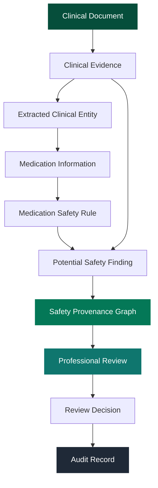
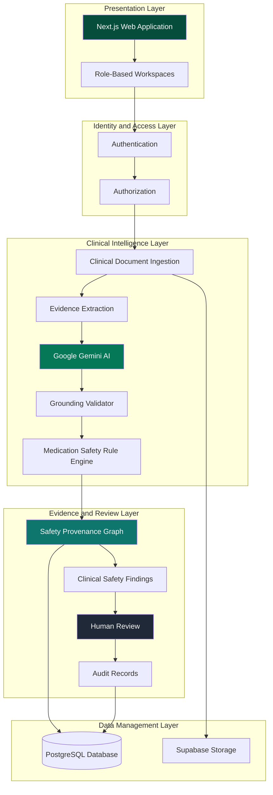
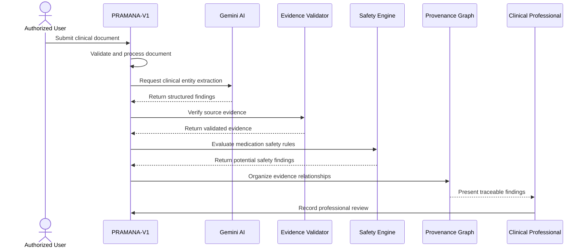

<div align="center">

# PRAMANA-V1

### Evidence-Grounded Clinical Intelligence & Medication Safety Platform

**Intelligence with Evidence. Safety with Accountability.**

*Transforming fragmented clinical records into transparent, traceable and actionable clinical safety intelligence.*

<br/>


<br/>

### Designed & Developed by TEAM UNKNOWN GENZ

**Kalaignar Karunanidhi Institute of Technology (KIT)**

Coimbatore, Tamil Nadu, India

---

[Overview](#-executive-overview) •
[Innovation](#-core-innovation) •
[Architecture](#-system-architecture) •
[Features](#-platform-capabilities) •
[Security](#-security-and-privacy) •
[Team](#-team-unknown-genz)

</div>

---

## 📌 Executive Overview

**PRAMANA-V1** is an AI-powered, evidence-grounded clinical intelligence and medication safety platform designed to support healthcare professionals in reviewing fragmented clinical information, identifying potential medication risks, and tracing clinical findings back to their original evidence.

The platform brings together generative AI, deterministic safety rules, clinical document processing, secure information management, and human-in-the-loop review within a unified digital ecosystem.

Unlike conventional healthcare chatbots that primarily generate conversational responses, PRAMANA-V1 focuses on the relationship between clinical information, supporting evidence, potential safety concerns, and professional accountability.

> Clinical intelligence should not merely provide an answer. It should demonstrate the evidence behind that answer.

---

## 🎯 Vision & Mission

### Vision

To contribute towards a healthcare ecosystem where AI-assisted clinical intelligence is transparent, evidence-grounded, accountable, and accessible.

### Mission

- Reduce the complexity of reviewing fragmented clinical information.
- Support the early identification of potential medication safety concerns.
- Improve traceability between clinical findings and original documents.
- Encourage responsible human-AI collaboration in healthcare.
- Strengthen transparency and accountability in AI-assisted clinical workflows.

---

## 🔍 Problem Statement

Modern healthcare environments generate substantial amounts of clinical information across prescriptions, laboratory reports, discharge summaries, and patient records.

However, fragmented information and inconsistent documentation can create challenges during clinical review.

| Challenge | Clinical Implication |
| :--- | :--- |
| Fragmented clinical records | Difficulty reviewing relevant patient information |
| Potential drug interactions | Medication safety concerns |
| Missing clinical evidence | Incomplete assessment |
| Contradictory documentation | Increased uncertainty |
| Unsupported AI-generated claims | Reduced confidence in AI assistance |
| Limited evidence traceability | Difficulty validating clinical findings |
| Manual information review | Increased administrative workload |

PRAMANA-V1 addresses these challenges through an integrated, evidence-oriented clinical intelligence workflow.

---

## 💡 Proposed Solution

PRAMANA-V1 introduces a structured approach to clinical document intelligence.

Clinical documents are processed to identify relevant entities, medications, and supporting evidence. Extracted information is subjected to grounding validation and medication safety rules before being organized into reviewable findings.

The platform is designed around five foundational principles:

| Principle | Purpose |
| :--- | :--- |
| Evidence First | Connect findings to original clinical information |
| Safety by Design | Separate medication safety rules from generative AI |
| Explainable Intelligence | Present understandable relationships between findings |
| Human Oversight | Maintain professional control over clinical decisions |
| Responsible Data Handling | Protect sensitive clinical information |

---

## 🧬 Core Innovation

### Safety Provenance Graph — SPG

The Safety Provenance Graph represents the central innovation of PRAMANA-V1.

It organizes clinical documents, extracted entities, medications, potential safety findings, and supporting evidence into a connected information structure.

Instead of presenting an isolated AI-generated warning, the platform aims to provide a traceable pathway explaining where the information originated and why it requires professional attention.



### Innovation Pillars

| Component | Contribution |
| :--- | :--- |
| Evidence Grounding | Associates extracted information with source text |
| Source Verification | Validates supporting quotations against documents |
| Deterministic Safety Engine | Evaluates defined medication safety rules independently of generative AI |
| Provenance Graph | Represents relationships between evidence and findings |
| Human-in-the-Loop | Enables qualified professional review |
| Auditability | Supports traceability of review activities |

The combination of these components forms the proposed differentiation of PRAMANA-V1.

---

## ⚙️ Platform Capabilities

### 01 — Authentication & Identity Management

- Secure authentication workflow.
- Role-based workspace access.
- Session management.
- Administrative account governance.
- Protected application routes.

### 02 — Clinical Document Intelligence

- Clinical document ingestion.
- Secure document storage.
- Clinical information extraction.
- Structured evidence processing.
- Document-to-finding traceability.

### 03 — Gemini Clinical Intelligence Engine

- Server-side Google Gemini integration.
- AI-assisted clinical entity extraction.
- Medication information extraction.
- Structured clinical information processing.
- Source-grounded evidence analysis.
- API error handling and retry mechanisms.

### 04 — Evidence Grounding & Validation

- Original source quotation verification.
- Character-offset evidence validation.
- Rejection of unsupported source quotations.
- Prompt injection mitigation.
- Evidence-oriented clinical review.

### 05 — Medication Safety Intelligence

- Potential drug-drug interaction screening.
- Deterministic medication safety rules.
- Medication-related warning generation.
- Supporting evidence presentation.
- Professional verification workflow.

### 06 — Safety Provenance Graph

- Connected clinical information representation.
- Medication and evidence relationships.
- Traceable safety findings.
- Interactive graph-oriented review.

### 07 — Institutional Governance

- Administrative workspace.
- Role-based access management.
- Professional review workflows.
- Review activity tracking.
- Audit-oriented accountability.

---

## 🏥 Role-Based Clinical Ecosystem

PRAMANA-V1 is designed around a multidisciplinary healthcare workflow.

| Workspace | Intended Responsibility |
| :--- | :--- |
| Doctor | Clinical evidence and safety finding review |
| Pharmacist | Medication safety and interaction assessment |
| Patient | Access to authorized personal clinical information |
| Administrator | Platform governance and authorized access management |

Actual access permissions are governed by the application's authorization configuration.

---

## 🏗️ System Architecture



The diagram illustrates the platform's high-level logical architecture.

---

## 🔄 End-to-End Clinical Workflow



---

## 🛠️ Technology Stack

| Technology | Architectural Responsibility |
| :--- | :--- |
| Next.js | Full-stack web application |
| TypeScript | Type-safe application development |
| React | Interactive user interface |
| Supabase | Authentication and data services |
| PostgreSQL | Structured relational data management |
| Supabase Storage | Clinical document storage |
| Google Gemini AI | AI-assisted clinical information extraction |
| Deterministic Rule Engine | Medication safety rule evaluation |
| Vercel | Cloud application deployment |
| GitHub | Source control and collaboration |

Dependency versions and runtime requirements are defined in the repository configuration.

---

## 🔐 Security and Privacy

PRAMANA-V1 adopts a security-oriented architecture appropriate for research-stage healthcare software development.

### Security Design

| Security Layer | Purpose |
| :--- | :--- |
| Authentication | Verify authorized user identity |
| Role-Based Authorization | Restrict access according to assigned permissions |
| Row-Level Security | Support database-level access restrictions |
| Server-Side AI Integration | Reduce exposure of sensitive API credentials |
| Private Document Storage | Restrict unauthorized document access |
| Input Validation | Reduce malformed and unexpected input risks |
| Prompt Injection Mitigation | Reduce manipulation through untrusted documents |
| Evidence Verification | Reject unsupported source quotations |
| Audit Logging | Support accountability and activity traceability |

### Responsible Data Handling

- API credentials must remain server-side.
- Environment secrets must not be committed to GitHub.
- Clinical records must be accessed only by authorized users.
- Synthetic or appropriately de-identified records should be used during demonstrations.
- External AI processing requires appropriate privacy and data governance review.

These controls represent security design objectives and reported implementation features. They do not constitute independent security certification or regulatory compliance.

---

## 🧪 Engineering Verification

The development process includes automated verification, production build checks, and documented implementation milestones.

<div align="center">


</div>

| Verification Metric | Reported Result |
| :--- | :--- |
| Phase 06 AI verification tests | 16/16 passed |
| Phase 06 production build | 36/36 routes compiled |
| Gemini API connectivity | Passed in Phase 06 testing |
| Clinical entity extraction | Passed in Phase 06 testing |
| Source quotation verification | Passed in Phase 06 testing |
| Development milestones | Phases 01–11 reported completed |

These results are based on development-phase reports and are not independent clinical validation results.

A successful software test does not establish clinical accuracy or patient safety.

---

## 📊 Project Development Lifecycle

| Milestone | Development Focus |
| :--- | :--- |
| Phase 01–03 | Project foundation and platform development |
| Phase 04 | Authentication and identity management |
| Phase 05 | Clinical document ingestion and evidence extraction |
| Phase 06 | Gemini clinical intelligence and safety engine |
| Phase 07 | Safety Provenance Graph and related integration |
| Phase 08–11 | Application integration, verification and deployment preparation |

---

## 🌍 Real-World Applications

PRAMANA-V1 explores potential applications across:

| Healthcare Environment | Potential Application |
| :--- | :--- |
| Hospitals | Clinical information review |
| Clinical Pharmacies | Medication safety assessment |
| Primary Healthcare | Structured clinical record review |
| Medical Institutions | Research and educational workflows |
| Healthcare Research | Evidence-grounded AI evaluation |
| Digital Healthcare Platforms | Traceable decision-support integration |

---

## 📈 Expected Impact

### Clinical Value

- Improved visibility of relevant clinical information.
- Better traceability of potential medication safety findings.
- Structured presentation of supporting evidence.
- Support for multidisciplinary professional collaboration.

### Operational Value

- Reduced manual information organization.
- Centralized clinical review workflows.
- Improved review documentation.
- Greater transparency in AI-assisted information processing.

### Societal Value

- Encouragement of responsible healthcare AI adoption.
- Support for safer digital healthcare innovation.
- Promotion of explainable and accountable AI systems.

These are intended benefits and require formal evaluation before clinical effectiveness can be established.

---

## 🚀 Local Development Setup

### Prerequisites

- Node.js compatible with the project configuration.
- npm.
- Git.
- Supabase project.
- Google Gemini API credentials.

### 1. Clone the Repository

```bash
git clone https://github.com/mohamedaflal1999786-code/Pramana-V1.git
cd Pramana-V1
```

### 2. Install Dependencies

```bash
npm install
```

### 3. Configure Environment Variables

Create a local environment configuration file using the repository's environment template, if available.

Example configuration:

```env
NEXT_PUBLIC_SUPABASE_URL=your-supabase-project-url
NEXT_PUBLIC_SUPABASE_ANON_KEY=your-public-anon-key
SUPABASE_SERVICE_ROLE_KEY=your-server-side-service-role-key
GEMINI_API_KEY=your-server-side-gemini-api-key
```

Use the exact environment variable names required by the application source code.

Never expose real credentials in documentation or commit environment secret files to GitHub.

### 4. Configure the Database

Apply the database schema, migrations, storage configuration, and authorization policies required by the project.

### 5. Start the Development Server

```bash
npm run dev
```

Open:

**http://localhost:3000**

### 6. Create a Production Build

```bash
npm run build
```

Refer to `package.json` for additional testing and verification commands.

---

## ☁️ Deployment

PRAMANA-V1 is designed for cloud deployment using Vercel.

<div align="center">

[](https://vercel.com/new/clone?repository-url=https%3A%2F%2Fgithub.com%2Fmohamedaflal1999786-code%2FPramana-V1)

</div>

### Deployment Requirements

1. Import the GitHub repository into Vercel.
2. Configure the required environment variables.
3. Configure the Supabase database and storage.
4. Configure authorized authentication redirect URLs.
5. Execute the production deployment.
6. Verify authentication and protected routes.
7. Validate the end-to-end clinical processing workflow.

A successful deployment does not constitute approval for real-world clinical use.

---

## 👥 Team Unknown GenZ

<div align="center">

### UNKNOWN GENZ

**Engineering Intelligence. Empowering Healthcare.**


</div>

### Team Leadership & Development

| Name | Department | Position |
| :--- | :--- | :--- |
| **Mohamed Aflal** | Artificial Intelligence & Data Science (AI&DS) | **Team Leader** |
| **Deepak** | Computer Science & Engineering (CSE) | Team Member |
| **Jayashree** | Electrical & Electronics Engineering (EEE) | Team Member |
| **Harish Guhan** | Computer Science & Engineering (CSE) | Team Member |

### Institutional Affiliation

**Kalaignar Karunanidhi Institute of Technology (KIT)**

Coimbatore, Tamil Nadu, India.

### Our Team Philosophy

Team Unknown GenZ brings together multidisciplinary engineering perspectives to explore meaningful technological solutions for real-world challenges.

Through PRAMANA-V1, our team aims to demonstrate how artificial intelligence, software engineering, evidence-based information processing, and responsible system design can contribute towards the future of digital healthcare.

> We believe that the future of healthcare AI must be built not only on intelligence, but also on evidence, transparency, safety, and human accountability.

---

## 🔭 Future Roadmap

- [ ] Independent clinical evaluation with qualified healthcare professionals.
- [ ] Expanded and professionally validated medication knowledge sources.
- [ ] Advanced clinical contradiction detection.
- [ ] Multilingual clinical document intelligence.
- [ ] HL7 FHIR interoperability exploration.
- [ ] Expanded evidence provenance capabilities.
- [ ] Institutional pilot evaluation.
- [ ] Accessibility improvements.
- [ ] Independent security and privacy assessment.
- [ ] Regulatory readiness evaluation.

---

## ⚖️ Responsible AI Principles

PRAMANA-V1 is developed around the following principles:

**Transparency** — Clinical findings should be understandable and traceable.

**Accountability** — Professional oversight should remain central to healthcare decisions.

**Privacy**