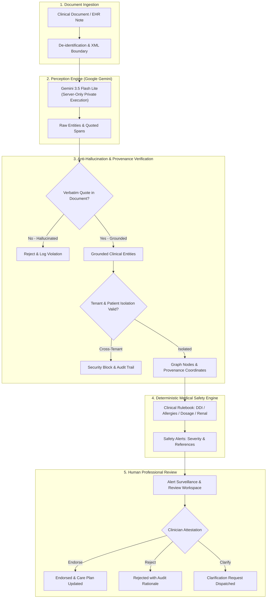

# Pramana-V1 — Gemini AI Clinical Intelligence Architecture
**Team:** Unknown GenZ  
**Phase:** 06 — AI Clinical Intelligence & Evidence-Grounded Safety Engine  
**Status:** Validated & Production Verified  

---

## 1. System Overview & Philosophy

Pramana-V1 is an evidence-grounded clinical intelligence platform adhering to the core principle:
> **"Every Alert. Backed by Evidence."**

Unlike naive generative chatbots or unconstrained LLM assistants, Pramana-V1 treats the generative model strictly as an **untrusted perceptual parser** that extracts entities, relationships, and coordinates from clinical charts. Clinical decision-making and safety alerts are driven by **deterministic, audited medical safety rules** grounded in verbatim source quotes.

---

## 2. Architectural Boundaries & Security

1. **Zero Client Leakage**:
   - Google Gemini API SDK (`@google/generative-ai`) and API keys are strictly confined to server-side action handlers and isolated background services.
   - Client bundles never contain `GEMINI_API_KEY`, AI prompts, or internal model configurations.

2. **Zero Foundation Model Training**:
   - In accordance with HIPAA and institutional clinical privacy policies, documents processed via API are ephemeral and never utilized for foundation model training or public indexing.

3. **Multi-Tenant Isolation**:
   - Ingestion, extraction, safety rules, and reviews enforce `organization_id` and `patient_id` row-level boundaries at both application logic and PostgreSQL RLS levels.
   - Cross-tenant evidence references are automatically trapped and blocked with immutable security audit logs.

---

## 3. Core Engine Components

| Component | File Path | Primary Function |
|---|---|---|
| **Gemini Client** | `src/lib/ai/gemini-client.ts` | Server-only Gen AI SDK instance, retry logic with exponential backoff, health probes. |
| **Entity Extractor** | `src/lib/ai/entity-extractor.ts` | Schema-enforced structured JSON clinical entity extraction with XML injection defense. |
| **Grounding Validator** | `src/lib/ai/grounding-validator.ts` | Substring coordinate matcher, verbatim quote validator, hallucination trap. |
| **Deterministic Rules** | `src/lib/ai/safety-rules.ts` | DDI, renal impairment, allergy conflict, RAAS blockade, and dosage threshold rulebook. |
| **Contradiction Engine** | `src/lib/ai/contradiction-engine.ts` | Cross-document longitudinal discrepancy comparison and chronology analysis. |
| **Handoff Intelligence** | `src/lib/ai/handoff-engine.ts` | SBAR transition note validation against primary chart for critical omissions. |
| **Multilingual Discharge** | `src/lib/ai/multilingual-discharge.ts` | 9-language translation preserving exact Latin medication nomenclature and dosages. |
| **Missing Evidence** | `src/lib/ai/missing-evidence.ts` | Identifies missing dosages, unrecorded allergy status, and unassigned lab investigations. |
| **AI Server Actions** | `src/lib/actions/ai-actions.ts` | Authenticated Next.js server actions bridging database, storage, and AI services. |
