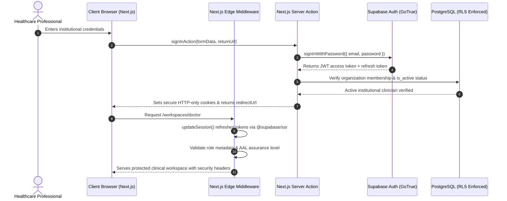
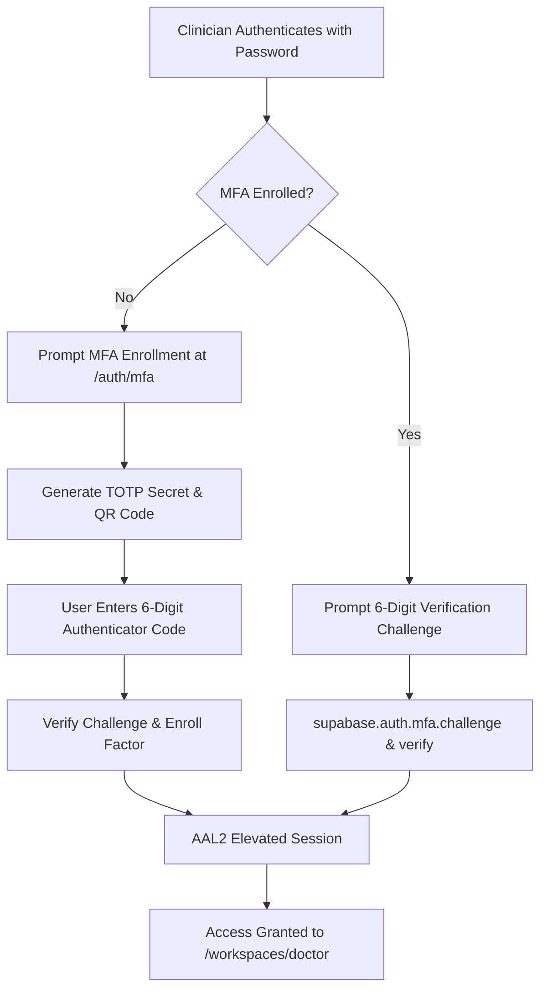

# Pramana-V1 — Authentication & Identity Architecture
**Team:** Unknown GenZ  
**Phase:** 04 — Production-Oriented Authentication, Identity Management & RBAC  
**Framework:** Next.js 14 App Router with `@supabase/ssr`  
**Identity Provider:** Supabase GoTrue Auth Service  
**Deployment Target:** Vercel  

---

## 1. Architectural Overview

Pramana-V1 implements a zero-trust, healthcare-grade authentication and session management architecture. Authentication tokens are managed strictly via secure, HTTP-only, SameSite cookies synchronized between the Next.js Edge Middleware, Server Components, Route Handlers, and Server Actions.

---

## 2. Core Authentication Subsystems

### 2.1 SSR Session Synchronizer (`@supabase/ssr`)
- **Server Client (`src/lib/supabase/server.ts`)**: Binds Supabase Auth sessions to Next.js cookie stores via `cookies()` from `next/headers`.
- **Browser Client (`src/lib/supabase/client.ts`)**: Creates a browser-safe client singleton utilizing standard publishable keys (`NEXT_PUBLIC_SUPABASE_ANON_KEY`).
- **Edge Middleware (`middleware.ts` & `src/lib/supabase/middleware.ts`)**: Synchronizes tokens on every incoming request, refreshes expiring access tokens, and applies defense-in-depth security response headers.

### 2.2 Proof Key for Code Exchange (PKCE) Callback Route
- **Route Handler (`/auth/callback/route.ts`)**:
  - Securely receives authorization codes from email verification links and password recovery emails.
  - Exchanges the code using `supabase.auth.exchangeCodeForSession(code)`.
  - Performs safe internal redirect URL sanitization (rejects open redirects, external protocols, and protocol-relative URLs).

### 2.3 Token OTP Confirmation Handler
- **Route Handler (`/auth/confirm/route.ts`)**:
  - Verifies cryptographic token hashes using `supabase.auth.verifyOtp({ token_hash, type })`.
  - Catches expired or tampered verification links and routes to `/auth/verify-email?error=token_invalid_or_expired`.

---

## 3. Multi-Factor Authentication (TOTP)

Pramana-V1 integrates native Supabase TOTP multi-factor authentication, elevating sessions from Authenticator Assurance Level 1 (`aal1`) to Level 2 (`aal2`).

- **MFA Enrollment (`enrollTotpFactorAction`)**: Generates standards-compliant TOTP secrets and SVG QR codes for Google Authenticator, 1Password, or Apple Keychain.
- **Challenge Verification (`verifyTotpFactorAction`)**: Dispatches challenge and verifies 6-digit TOTP code against cryptographic server timestamps.
- **Factor Removal (`unenrollTotpFactorAction`)**: Disables factors with mandatory re-authentication and audit logging.

---

## 4. Edge Security & HTTP Hardening

The Edge Middleware enforces strict HTTP headers across all application routes:

| Header | Configured Value | Security Purpose |
| :--- | :--- | :--- |
| `X-Frame-Options` | `DENY` | Prevents clickjacking and UI redress attacks |
| `X-Content-Type-Options` | `nosniff` | Blocks MIME-type sniffing |
| `Referrer-Policy` | `strict-origin-when-cross-origin` | Protects patient MRN and clinical URLs from leaking |
| `Permissions-Policy` | `camera=(), microphone=(), geolocation=()` | Blocks hardware sensor access |
| `Content-Security-Policy` | `default-src 'self'; script-src 'self' ...` | Prevents cross-site scripting (XSS) and unauthorized script injection |

---

## 5. Audit Logging Trail

All authentication lifecycle events are logged to the immutable `audit_logs` database table via `logAuditEvent()` in `src/lib/auth/audit.ts`.

- **Logged Actions**: `auth.login_success`, `auth.login_failed`, `auth.logout`, `auth.signup_requested`, `auth.password_reset_requested`, `auth.password_reset_completed`, `auth.mfa_enrolled`, `auth.mfa_verified`, `auth.mfa_disabled`, `account.approved`, `account.suspended`.
- **Healthcare Privacy Safeguard**: Passwords, OTP codes, session tokens, and clinical document contents are cryptographically scrubbed and redacted before persistence.
