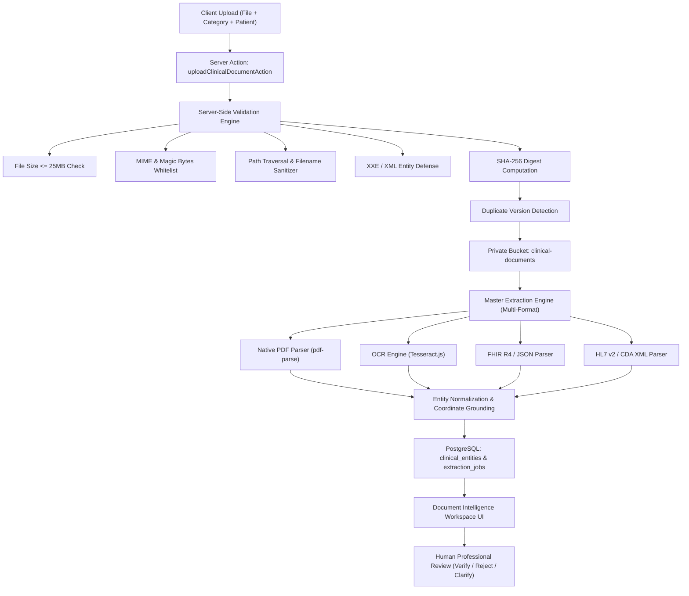

# Document Ingestion Architecture — Pramana-V1
**Phase 05 Architecture Reference**
**Team:** Unknown GenZ
**Security Classification:** Strict Healthcare Privacy (Synthetic Fixtures Only)

---

## 1. Overview
The Pramana-V1 Clinical Document Ingestion and Evidence Extraction Pipeline enables multi-modal clinical document ingestion, server-side cryptographic and semantic validation, private cloud storage isolation, automated evidence extraction, deterministic entity identification, and human professional review.



---

## 2. Supported Formats & MIME Matrix

| Format | Extensions | Canonical MIME Type | Validation Mechanism | Parser / Extractor |
| :--- | :--- | :--- | :--- | :--- |
| **PDF** | `.pdf` | `application/pdf` | Magic Bytes `%PDF-` | `pdf-parse` (Page-by-page text) |
| **Plain Text** | `.txt` | `text/plain` | UTF-8 Content Check | Line / Character Offset Parser |
| **FHIR / JSON** | `.json` | `application/json` | JSON Schema / `resourceType` | Recursive JSONPath Walker |
| **CDA / XML** | `.xml` | `application/xml`, `text/xml` | XXE RegEx Guard | CDA Clinical Section Extractor |
| **HL7 v2** | `.hl7`, `.txt` | `application/hl7-v2+er7` | MSH Header Detection | ER7 Segment Parser (`PID`, `RXE`, `AL1`) |
| **JPEG** | `.jpg`, `.jpeg` | `image/jpeg` | Magic Bytes `\xFF\xD8\xFF` | Tesseract.js OCR (Eng) |
| **PNG** | `.png` | `image/png` | Magic Bytes `\x89PNG\r\n\x1a\n` | Tesseract.js OCR (Eng) |

---

## 3. Storage Hierarchy & Tenant Isolation

Clinical files are strictly isolated by organization and patient in the private Supabase Storage bucket `clinical-documents`:

```
clinical-documents/
└── {organization_id}/
    └── {patient_id}/
        └── {timestamp}_{sanitized_filename}
```

- **Bucket Policy**: `public = false`
- **Max File Size**: 26,214,400 bytes (25 MB)
- **Direct Access**: Disabled (all requests require short-lived HMAC signed URLs with max 300s TTL).
- **Anti-Traversal Protection**: Filenames are sanitized via `replace(/[^\w.-]/g, "_")` and restricted to base filenames.
