# Pramana-V1 Database Entity-Relationship Diagram (ERD)
**Project**: Pramana-V1 ("Every Alert. Backed by Evidence.")  
**Team**: Unknown GenZ  
**Database**: PostgreSQL 15+ (Supabase)  
**Specification**: 31 Relational Tables across 6 Functional Domains  

---

```mermaid
erDiagram
    %% =========================================================================
    %% DOMAIN 1: INSTITUTIONAL MANAGEMENT & RBAC
    %% =========================================================================
    organizations ||--o{ organization_members : "employs"
    organizations ||--o{ invitations : "issues"
    organizations ||--o{ account_approval_requests : "receives"
    profiles ||--o{ organization_members : "assigned_to"
    profiles ||--o{ account_approval_requests : "requests"
    roles ||--o{ organization_members : "designates"
    roles ||--o{ role_permissions : "contains"
    permissions ||--o{ role_permissions : "granted_in"

    organizations {
        uuid id PK
        text name
        text slug UK
        text domain
        text tier
        boolean is_active
        timestamptz created_at
        timestamptz updated_at
    }

    profiles {
        uuid id PK
        text full_name
        text email UK
        text phone
        text avatar_url
        timestamptz created_at
    }

    roles {
        text id PK
        text name
        text description
        boolean is_clinical
    }

    organization_members {
        uuid id PK
        uuid organization_id FK
        uuid user_id FK
        text role_id FK
        text department
        text license_number
        boolean is_active
    }

    %% =========================================================================
    %% DOMAIN 2: PATIENT & ENCOUNTER MANAGEMENT
    %% =========================================================================
    organizations ||--o{ patients : "registers"
    patients ||--o{ encounters : "undergoes"
    patients ||--o{ patient_access : "grants"
    profiles ||--o{ patient_access : "holds_proxy"
    profiles ||--o{ encounters : "attends"

    patients {
        uuid id PK
        uuid organization_id FK
        text mrn
        text first_name
        text last_name
        date date_of_birth
        text gender
        boolean is_synthetic
    }

    patient_access {
        uuid id PK
        uuid organization_id FK
        uuid patient_id FK
        uuid user_id FK
        text access_level
        boolean is_active
    }

    encounters {
        uuid id PK
        uuid organization_id FK
        uuid patient_id FK
        text encounter_number
        text encounter_type
        uuid attending_physician_id FK
        timestamptz admission_date
        timestamptz discharge_date
        text status
    }

    %% =========================================================================
    %% DOMAIN 3: CLINICAL INTELLIGENCE
    %% =========================================================================
    patients ||--o{ clinical_documents : "owns_records"
    clinical_documents ||--o{ document_versions : "has_versions"
    document_versions ||--o{ extraction_jobs : "processed_by"
    document_versions ||--o{ clinical_entities : "yields_entities"
    patients ||--o{ clinical_entities : "clinical_state"
    patients ||--o{ medications : "prescribed"
    patients ||--o{ allergies : "hypersensitive_to"
    patients ||--o{ lab_results : "tested_for"

    clinical_documents {
        uuid id PK
        uuid organization_id FK
        uuid patient_id FK
        uuid encounter_id FK
        text title
        text document_type
        text mime_type
        bigint file_size_bytes
        text storage_path
        int current_version_number
        text quarantine_status
    }

    document_versions {
        uuid id PK
        uuid organization_id FK
        uuid document_id FK
        int version_number
        text sha256_hash
        text storage_path
    }

    extraction_jobs {
        uuid id PK
        uuid organization_id FK
        uuid document_version_id FK
        text status
        text model_version
    }

    clinical_entities {
        uuid id PK
        uuid organization_id FK
        uuid document_version_id FK
        uuid patient_id FK
        text entity_type
        text raw_text
        text normalized_code
        jsonb source_location
        numeric confidence_score
        boolean is_verified
    }

    %% =========================================================================
    %% DOMAIN 4: SAFETY PROVENANCE GRAPH
    %% =========================================================================
    safety_rules ||--o{ safety_rule_versions : "versioned_into"
    safety_rule_versions ||--o{ safety_alerts : "evaluates"
    patients ||--o{ safety_alerts : "subject_of_alert"
    patients ||--o{ evidence_nodes : "graph_vertices"
    evidence_nodes ||--o{ evidence_edges : "source_edge"
    evidence_nodes ||--o{ evidence_edges : "target_edge"

    safety_rules {
        uuid id PK
        text rule_code UK
        text name
        text category
        text severity
        text description
        text clinical_rationale
    }

    safety_rule_versions {
        uuid id PK
        uuid rule_id FK
        int version_number
        jsonb logic_definition
    }

    safety_alerts {
        uuid id PK
        uuid organization_id FK
        uuid patient_id FK
        uuid rule_version_id FK
        text severity
        text title
        text summary
        text status
        numeric confidence_score
    }

    evidence_nodes {
        uuid id PK
        uuid organization_id FK
        uuid patient_id FK
        text node_type
        uuid reference_id
        text label
        jsonb metadata
    }

    evidence_edges {
        uuid id PK
        uuid organization_id FK
        uuid patient_id FK
        uuid source_node_id FK
        uuid target_node_id FK
        text relationship_type
        numeric weight
    }

    %% =========================================================================
    %% DOMAIN 5: PROFESSIONAL VERIFICATION
    %% =========================================================================
    safety_alerts ||--o{ clinical_reviews : "adjudicated_in"
    encounters ||--o{ handoff_reviews : "handed_off_during"
    patients ||--o{ discharge_instructions : "receives_plan"
    discharge_instructions ||--o{ discharge_translations : "translated_into"
    document_versions ||--o{ professional_attestations : "attested_under"
    profiles ||--o{ professional_attestations : "signed_by"

    clinical_reviews {
        uuid id PK
        uuid organization_id FK
        uuid alert_id FK
        uuid reviewer_id FK
        text review_decision
        text clinical_rationale
    }

    handoff_reviews {
        uuid id PK
        uuid organization_id FK
        uuid encounter_id FK
        uuid outgoing_clinician_id FK
        uuid incoming_clinician_id FK
        boolean critical_actions_reviewed
        text handoff_status
    }

    discharge_instructions {
        uuid id PK
        uuid organization_id FK
        uuid patient_id FK
        text primary_language
        boolean is_verified
    }

    discharge_translations {
        uuid id PK
        uuid instruction_id FK
        text language_code
        jsonb translated_content
        boolean is_professionally_approved
    }

    professional_attestations {
        uuid id PK
        uuid organization_id FK
        uuid attestor_id FK
        uuid document_version_id FK
        text evidence_chain_hash
        text attestation_statement
        boolean is_revoked
    }

    %% =========================================================================
    %% DOMAIN 6: PLATFORM GOVERNANCE
    %% =========================================================================
    audit_logs {
        uuid id PK
        uuid organization_id FK
        uuid actor_id FK
        text action
        text entity_type
        uuid entity_id
        jsonb details
        timestamptz timestamp
    }

    contact_inquiries {
        uuid id PK
        text name
        text email
        text organization_name
        text role_title
        text inquiry_type
        text message
        boolean is_reviewed
        text ip_hash
        timestamptz created_at
    }

    consent_records {
        uuid id PK
        uuid organization_id FK
        uuid patient_id FK
        text consent_type
        text status
        uuid granted_by FK
        timestamptz valid_until
    }
```

