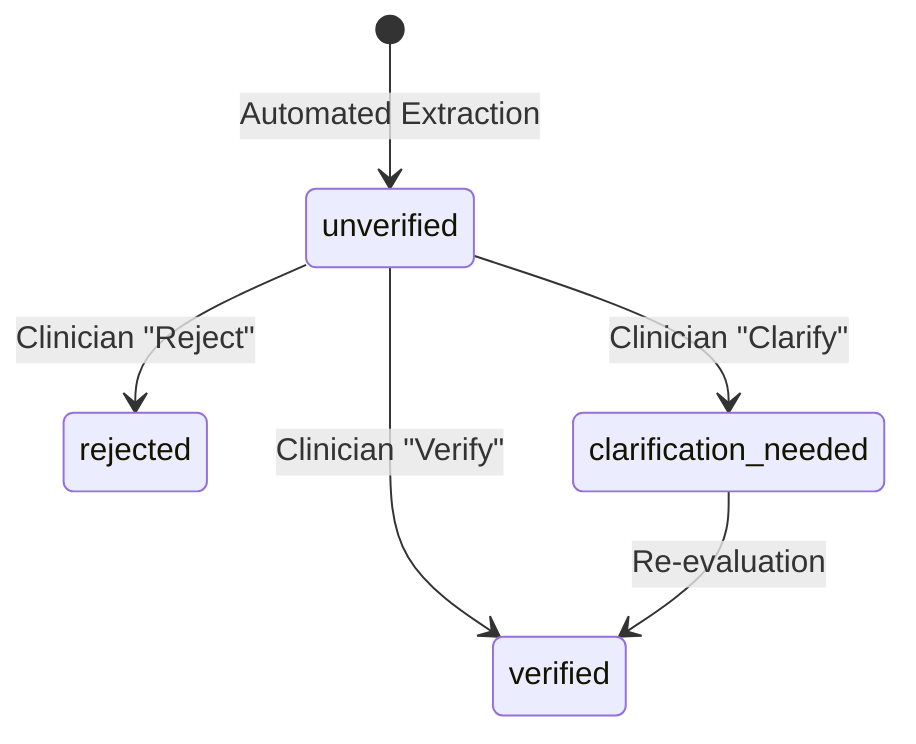

# Extraction Engine Specification — Pramana-V1
**Phase 05 Engine Specification**
**Team:** Unknown GenZ

---

## 1. Engine Purpose
The Pramana-V1 Extraction Engine (`src/lib/extraction/engine.ts`) is designed to transform unstructured and semi-structured clinical documents into strongly typed, provenance-grounded entities without relying on external third-party proprietary LLMs (prior to Phase 06).

---

## 2. Evidence Grounding Coordinates

Every extracted clinical entity (`clinical_entities`) is persisted with precise provenance coordinates in the `source_location` JSONB field:

### 2.1 Native PDF Documents
```json
{
  "pageNumber": 1,
  "startOffset": 142,
  "endOffset": 158,
  "lineIndex": 12
}
```

### 2.2 Scanned Images & OCR Scans
```json
{
  "pageNumber": 1,
  "boundingBox": {
    "x0": 120,
    "y0": 340,
    "x1": 280,
    "y1": 365
  }
}
```

### 2.3 FHIR R4 JSON Bundles
```json
{
  "jsonPath": "Bundle.entry[2].resource(MedicationRequest).medicationCodeableConcept.coding[0].display"
}
```

### 2.4 HL7 v2 Message Segments
```json
{
  "hl7Segment": "RXE-2[1]"
}
```

---

## 3. Entity Classification & Normalization

The engine deterministically extracts and classifies:
1. **Medications (`medication`)**:
   - Matches: Metformin, Lisinopril, Warfarin, Aspirin, Clopidogrel, Atorvastatin, Amoxicillin, Levothyroxine, etc.
   - Grounding: Dosages, frequencies, and exact line/character offsets.
2. **Allergies & Intolerances (`allergy`)**:
   - Matches: Penicillin, Sulfa, NSAIDs, Cephalosporins, Peanuts, Latex, Contrast dye.
   - Grounding: Reaction description, severity, allergen code.
3. **Lab Results (`lab_result`)**:
   - Matches: Serum Creatinine, eGFR, Potassium, Hemoglobin A1c, INR, Platelets.
   - Grounding: Quantitative values, reference units (`mg/dL`, `mEq/L`, `%`), test date.

---

## 4. Human Professional Review Lifecycle

Entities enter the provenance store in the `unverified` status. Verified clinicians can transition each entity through a state machine:



- Elevation updates `clinical_entities.is_verified` and records the clinician's UUID in `clinical_entities.verified_by`.
- An immutable audit trail entry is posted to `audit_logs` for every status change.
