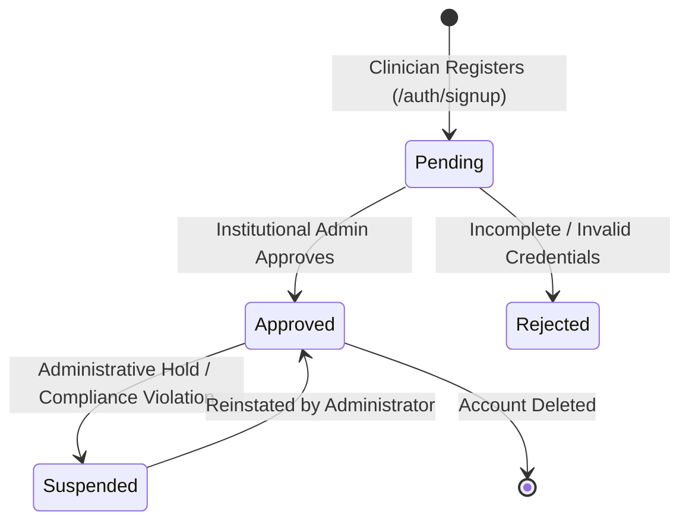

# Pramana-V1 — Role-Based Access Control (RBAC) Permission Matrix
**Team:** Unknown GenZ  
**Phase:** 04 — Production-Oriented Authentication, Identity Management & RBAC  
**Database:** PostgreSQL with Row Level Security (RLS)  

---

## 1. System Role Definitions

Pramana-V1 defines six distinct roles stored in the authoritative `roles` table. Privileges are never determined from unverified client metadata.

| Role ID | Display Name | Clinical Flag | Primary Operational Scope |
| :--- | :--- | :---: | :--- |
| `platform_admin` | Platform Administrator | No | Global multi-tenant configuration, system telemetry, and platform governance |
| `institutional_admin`| Institutional Administrator | No | Hospital facility onboarding, clinician approval, account suspension, and compliance audit |
| `doctor` | Attending Physician | **Yes** | Clinical document ingestion, safety alert adjudication, and physician attestation |
| `pharmacist` | Clinical Pharmacist | **Yes** | Medication reconciliation, interaction review, and pharmacovigilance surveillance |
| `safety_officer` | Clinical Safety Officer | **Yes** | Systemic safety oversight, incident investigation, rule versioning, and audit ledger review |
| `patient` | Patient / Authorized Proxy | No | Plain-language care summaries, multilingual discharge guidance, and personal record access |

---

## 2. Granular Permissions Registry

| Permission Code | Category | Description | Assigned Roles |
| :--- | :--- | :--- | :--- |
| `org.manage` | Governance | Manage organization configuration, members, and tier | `platform_admin`, `institutional_admin` |
| `org.view_audit` | Governance | Read institutional audit trail records and compliance logs | `platform_admin`, `institutional_admin`, `safety_officer` |
| `clinical.ingest` | Clinical | Ingest clinical notes, discharge summaries, and lab records | `doctor`, `platform_admin` |
| `clinical.view` | Clinical | Access patient medical history, entities, and extraction graphs | `doctor`, `pharmacist`, `safety_officer` |
| `clinical.verify` | Clinical | Adjudicate clinical alerts and generate physician attestations | `doctor`, `safety_officer` |
| `pharmacy.reconcile`| Clinical | Resolve medication discrepancies and drug-drug interactions | `pharmacist` |
| `safety.triage` | Safety | Triage high-priority safety discrepancies and review rules | `safety_officer` |
| `patient.read_own` | Patient | Read verified care plans and discharge instructions for self | `patient` |

---

## 3. Workspace Route Authorization Matrix

| Workspace Route | Permitted Roles | Unauthorized Action |
| :--- | :--- | :--- |
| `/workspaces/doctor` | `doctor`, `safety_officer`, `institutional_admin`, `platform_admin` | Redirects to `/auth/access-denied?reason=clinical_privilege_required` |
| `/workspaces/pharmacist` | `pharmacist`, `safety_officer`, `institutional_admin`, `platform_admin` | Redirects to `/auth/access-denied?reason=pharmacy_privilege_required` |
| `/workspaces/patient` | `patient`, `platform_admin` | Redirects to `/auth/access-denied?reason=patient_privilege_required` |
| `/workspaces/admin` | `institutional_admin`, `platform_admin` | Redirects to `/auth/access-denied?reason=admin_privilege_required` |
| `/workspaces/documents` | `doctor`, `pharmacist`, `safety_officer`, `platform_admin` | Redirects to `/auth/access-denied` |
| `/workspaces/graph` | `doctor`, `pharmacist`, `safety_officer`, `platform_admin` | Redirects to `/auth/access-denied` |
| `/workspaces/medications`| `doctor`, `pharmacist`, `safety_officer`, `platform_admin` | Redirects to `/auth/access-denied` |
| `/workspaces/handoffs` | `doctor`, `pharmacist`, `safety_officer`, `platform_admin` | Redirects to `/auth/access-denied` |
| `/workspaces/alerts` | `doctor`, `pharmacist`, `safety_officer`, `platform_admin` | Redirects to `/auth/access-denied` |
| `/workspaces/discharge` | `doctor`, `pharmacist`, `safety_officer`, `platform_admin` | Redirects to `/auth/access-denied` |
| `/workspaces/review` | `doctor`, `pharmacist`, `safety_officer`, `platform_admin` | Redirects to `/auth/access-denied` |

---

## 4. Account Lifecycle States

All registrations undergo institutional verification before accessing clinical data:

- **`pending` (`is_active = false`)**: Account registered. Blocked by database RLS from all clinical and patient data. Middleware routes user to `/auth/pending-approval`.
- **`approved` (`is_active = true`)**: Institutional credentials verified. Granted role-specific workspace access and database read/write permissions.
- **`suspended` (`is_active = false`)**: Access revoked immediately. RLS policy checks `om.is_active = true`, causing queries to instantly return 0 rows.
- **`rejected`**: Registration rejected by institutional administrator with documented rejection reason.

---

## 5. Privilege Escalation Defenses

1. **Self-Approval Prohibition**: Database constraint `chk_no_self_approval` on `account_approval_requests` (`CHECK (user_id != reviewed_by)`) strictly prohibits users from approving their own account.
2. **Metadata Tampering Resistance**: Authorization checks query the PostgreSQL `organization_members` table rather than user-editable JWT `user_metadata`.
3. **Least Privilege Separation**: Institutional administrators have administrative and audit rights but are strictly barred from clinical patient records and medication data unless explicitly granted a clinical role.
